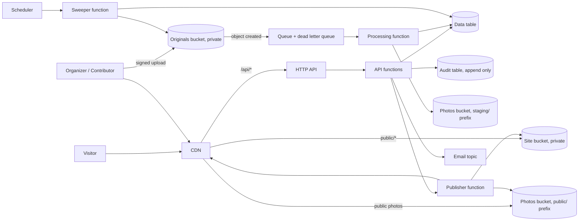

# High-level design

This is the one place for the high-level design. Load it for any design, task or build work. Do not copy it into a spec. The spec `design.md` links here and adds detail only. If a spec changes the overall design, change this file in the same change.

Requirements: [requirements.md](requirements.md). Rules: [tech.md](tech.md). Status: draft for owner review. The owner's decisions of 2026-11-06 and 2026-11-07 are in section 8. The wall and the phone experience are in section 11.

Criterion IDs such as R10.4 or N4.1 are the requirement ID plus the criterion number in [requirements.md](requirements.md).

## 1. Architecture on AWS

Every installation is one stack in one AWS account. Nothing is shared between groups.

Parts:

- **CDN.** The only public entry. Reads buckets with origin access control. No bucket is public (N1.2 to N1.4).
- **Site bucket.** Static HTML, JSON and assets. Written only by the publisher and the install step.
- **Photos bucket.** Two prefixes. `staging/` holds thumbnails and web sizes of photos not yet published. The CDN does not serve it. `public/` holds published copies. The CDN serves only `public/`.
- **Originals bucket.** Private. Never behind the CDN. Read only by the processing function and by organizer download through a signed address.
- **API and functions.** One HTTP API. Small functions for events, photos, removal requests, roles and export. Public routes are the removal request and read routes. All others need a signed-in user.
- **Publisher.** Renders the static pages (HTML for sharing previews, JSON for data), writes them to the site bucket, copies or deletes photo copies in `public/`, and invalidates CDN paths. Every public change goes through it.
- **Wall file.** One prebuilt JSON file in the Site bucket (`public/wall.json`) lists the picked photos in wall order. The CDN serves it with a cache of about a minute (N8.1). The publisher rewrites it on every publish, pick, unpick, hide and removal.
- **Processing.** An object-created event goes to a queue, then to a function. Failed items go to a dead letter queue.
- **Data table and audit table.** Two DynamoDB tables, on-demand billing. The audit table accepts only new items.
- **Email topic.** Organizer notices by email.
- **Scheduler and sweeper.** A daily job for retention and for review deadline reminders.
- **Sign-in.** Cognito user pool, behind one interface (decision 1). The API checks the token and reads the role from the data table.

Why static pages: no server to patch, low cost, and sharing previews need real HTML (R13.4). Cost to change: a dynamic render layer would need functions at the edge or a server. Medium.

## 2. Data model

Groups are not a table. There is no group key anywhere. The group's slug is in the configuration and is used to name the resources and in public addresses only.

Data table (single table, key names `PK`, `SK`; two indexes):

| Item | PK | SK | Main attributes |
|---|---|---|---|
| Event | `EVENT#<id>` | `META` | title, start, venue, meetup_url, speakers, description (per language), attendance, year, state |
| Photo | `EVENT#<id>` | `PHOTO#<id>` | status, photographer, licence, alt text per language, capture_time, time_is_estimate, picked, size, object keys, published_at |
| Wall settings | `SETTINGS` | `WALL` | cap of picks per event, number of picks for each year position |
| Removal request | `REMOVAL#<id>` | `META` | photo ref, created_at, status, decided_by, decided_at, decision |
| User | `USER#<subject>` | `META` | email, role (organizer or contributor), added_by |
| Rate counter | `RATE#<salted hash>` | `<window>` | count, expires_at (TTL) |

- Index 1 (by year): `year` + `start`. Serves the history lists and the year filter (R4.1 to R4.3).
- Index 2 (by status): `status` + `created_at` for photos and removal requests. Serves the moderation queue and open requests.
- Photo status values: `uploading`, `processing`, `ready` (hidden, R8.1), `published`, `hidden_pending_removal`, `removed`, `failed`.
- Photo licence is copied from the configuration default at upload time and stored on the photo. A later change of the default does not change old photos (R11.3, R11.4).

Audit table: `PK = AUDIT#<yyyy-mm>`, `SK = <timestamp>#<id>`. Items: actor, action, target, detail, time. Only `PutItem` with a condition "not exists" is allowed. No function has update or delete rights. Point-in-time recovery on.

Rate counters hold a salted hash of the address, never the address. The salt rotates. They expire by TTL after the window.

Objects:

- `originals/<event>/<photo>` (Originals bucket).
- `staging/<event>/<photo>/{thumb,web}.jpg` and `public/<event>/<photo>/{thumb,web}.jpg` (Photos bucket). `thumb` is the tile size (about 480 px) and `web` is the viewer size (about 1600 px). Both are made once, at upload (N8.5).
- `public/...` pages, `wall.json` and `config.json` (Site bucket).

Cost to change the model: a single table is easy to extend. Splitting it later is a copy job. Low.

## 3. How each requirement is met

| ID | How |
|---|---|
| R1 | One validated configuration file. Build and install read it. Code has no group names. A check in the tests searches the code for the example group's name. |
| R2 | One install command and one remove command. Both wrap SAM (decision 2): `sam build` and `sam deploy`, and `sam delete`. Remove deletes the stack. Stateful resources are listed in the guide, with a choice to keep or delete them. |
| R3 | Events API with organizer-only write. Attendance can be edited at any time. |
| R4 | Index 1 for lists and the year filter. Pages are rendered by the publisher. Bulk import is a command that reads a JSON file and writes events through the same API. |
| R5 | Export function asks the publisher for a standalone page at a stable address with date, venue, Meetup address, attendance and published photos (links to `public/` copies). |
| R6 | Browser asks the API for signed upload addresses, one per file, and uploads straight to the Originals bucket. The signed address limits size and type. Files do not go through a function. |
| R7 | Processing function makes the tile size and the viewer size, removes location data, keeps the capture time in the record, never touches the original. |
| R8 | New photos land as `ready`, copies in `staging/`. Only the publish action copies to `public/`. |
| R9 | The album template always shows the consent text for the page language. It cannot be switched off. The wall and the viewer never show it (R9.3). |
| R10 | See section 5. "At once" means within seconds: the public copy is deleted and the wall file is rewritten first, then the cache is cleared (R10.6). |
| R11 | Photographer stored per photo and shown in small type on the album page and in the viewer, not on wall tiles (R11.5). Licence stored per photo, set from the default, changeable by an organizer. |
| R12 | No recognition service is used or called. The code has no tagging path. The opt-in in R12.3 is an open decision and is not built until decided (see gaps). |
| R13 | Gallery template with a keyboard-operable enlarged view, and a playback of the photos in capture time order (R13.5). The publisher writes sharing preview tags from the cover photo. |
| R14 | Every template takes strings from language files. One page set per language. The build fails if a string is missing. |
| R15 | Semantic templates, automated checks in tests, a manual checklist per release. Alt text is a field on each photo. |
| R16 | User items hold the role. The API checks the role on every write. Publish and removal decisions are organizer only. |
| N1 | Managed services only. Private buckets. CDN with origin access control. |
| N2 | On-demand services, no always-on parts, no firewall subscription by default. The guide shows how the cost figure was measured. |
| N3 | No cookies set by the public site. No third-party scripts or analytics. Fonts and assets are served from the site. Retention is in the configuration and applied by the sweeper. |
| N4 | HTTP API throttling plus rate counters for removal requests and upload addresses. Values come from the configuration (see gaps). |
| N5 | Tests run in a hosted CI on every change. The CI service is not named in the requirements (see gaps). |
| N6 | A guide and a first-event walk-through. A timed run by someone new is part of the release check. |
| N7 | MIT licence file at the root. |
| R17 | The home page renders the wall from `wall.json` (section 11). Order, caps, shares and piles follow R17.1 to R17.9. |
| R18 | The viewer is an overlay in the home page script. It reads `wall.json`, uses the address fragment for deep links and the back button, and handles keyboard and swipe (R18.1 to R18.9). |
| R19 | Capture time comes from the file. If it is missing the upload time is used and flagged. Organizers edit one photo or shift an event (R19.1 to R19.4). |
| R20 | A static page built from the configuration (consent text, retention) and linked from the footer of every public page. |
| R21 | The organizer wall page picks photos, sets the cap and the shares, lists events with no pick, and previews the wall. Settings are stored in the `SETTINGS` item (R21.1 to R21.6). |
| R22 | One stylesheet with narrow-screen rules (640 px): tab bar, slim top bar, edge to edge wall, year bar, back-to-top button, compact footer, safe areas, touch sizes. A test checks every page for sideways overflow at 390 px (R22.9). |
| R23 | The organizer area uses its own tab bar and More sheet at 760 px, tables become cards, and photo upload offers choose or camera (R23.1 to R23.8). |
| R24 | A web app manifest and icons are generated at build time from the configuration (R24.1 to R24.3). |
| N8 | A prebuilt `wall.json` with a short cache, rewritten by the publisher, cache cleared on hide or removal. Two image sizes made at upload. No API call per wall visit. |

## 4. Photo pipeline: upload to publication to removal

1. **Request.** An organizer or contributor picks files. The browser asks the API for upload addresses. The API checks the role, the type, the size limit and the rate counter, creates photo items as `uploading`, and returns signed addresses (R6.1 to R6.3, N4.2).
2. **Upload.** The browser sends each file straight to the Originals bucket (R6.4). A bad type or size is refused by the signed address, and the page shows the reason (R6.5).
3. **Process.** Object created → queue → function. It reads the original, rejects files that are not real images, writes the tile size and the viewer size to `staging/` without location data (R7.1 to R7.3), stores the capture time (or the upload time marked as an estimate, R19.2), and sets `ready`. Failures retry, then go to the dead letter queue and the photo is `failed`.
4. **Review.** Organizers see `ready` photos in the moderation queue. They set alt text, licence and cover photo, and publish or leave hidden (R8.1, R15.2, R11.4).
5. **Publish.** The publisher copies the two files to `public/`, sets `published`, renders the album and event pages, rewrites `wall.json` when the photo is picked, and invalidates those paths. An audit entry is written.
6. **Hide or remove.** A removal request or an organizer unpublish deletes the `public/` copies, sets the status, re-renders the pages, rewrites `wall.json` and invalidates the paths. The photo is gone from the CDN within seconds (R10.6, N8.3). See section 5.
7. **Retention.** The sweeper deletes originals of unpublished photos older than `retention_days`. It writes an audit entry for each run (N3.3, N3.4).

The original stays in the Originals bucket and is never served by the CDN (R7.5).

## 5. Removal request flow and audit log

1. A visitor presses Request removal on a photo. The request goes to a public route (rate limited, N4.1).
2. One transaction does three things: set the photo to `hidden_pending_removal`, create the removal request with its date, and write the audit entry `removal.requested` (R10.2).
3. The publisher deletes the `public/` copies, re-renders the album, rewrites `wall.json` and invalidates paths (R10.1, R10.4, R10.6).
4. The email topic notifies the organizers (R10.3).
5. An organizer opens the request and decides. The decision is `approve` or `reject`. The API checks the organizer role (R16.4).
   - `approve`: the photo becomes `removed`, the derived copies are deleted. The original follows the rule in the gaps list. Audit entry `removal.approved`.
   - `reject`: the photo returns to `published` and the publisher restores it. Audit entry `removal.rejected`, with the reason.
6. On day `takedown_review_days`, the sweeper sends a reminder for every undecided request (R10.5). The photo stays hidden until someone decides.

Audit entries: who, what, which photo or request, when. They hold no visitor address and no visitor contact. They are append only. Organizers can read them in the admin page. Export is a command.

Cost to change: moving the audit log to another store (for example object lock in a bucket) means a one-time copy and a new writer. Low to medium.

## 6. How the configuration file drives the site

- The file is `config/group.yml` in the group's own copy. `config/group.example.yml` is the model.
- A schema checks it. The build and the install stop with a clear message if a key is missing or wrong.
- At build time it feeds the templates: names, colour, languages, Meetup address, consent text.
- At install time it feeds the functions as settings: licence default, review days, retention, size limit, rate limits.
- A compiled copy is written to the site bucket as `config.json` for the admin pages. It holds nothing secret.
- Colour is checked against a contrast rule at build time (R15.1).
- Keys to add to the example (not in it today): maximum upload size, maximum files per upload, rate limit values, the base address once there is a domain, the talk proposal address (`site.talk_url`), the first values of the wall settings (cap per event, picks for each year position), and the manifest name and colours. The example file is not changed yet. Adding keys needs the owner's approval of the schema.
- The wall settings can be edited by organizers at run time. The configuration holds the first values and the `SETTINGS` item holds the current ones.
- Nothing about a group is in the code. The tests include a second sample configuration, and run the build on both (R1.9).

## 7. Install and removal for a new group

Install, in 30 minutes (N6):

1. Fork or clone the repository.
2. Copy `config/group.example.yml` to `config/group.yml` and edit it.
3. Run the check command. It validates the file.
4. Run the install command with AWS credentials. It deploys the stack, builds the site, uploads it and creates the first organizer.
5. Open the address it prints. Sign in. Create the first event.

Removal:

1. Run the remove command.
2. It asks whether to keep or delete the data table, the audit table and the buckets. Default is keep.
3. It prints what is left in the account and how to delete it.

Several installs can live in one account. The slug names the resources.

## 8. Decisions and what they cost to change

The points still open are listed in Open decisions in [requirements.md](requirements.md) (20 items).

Decided by the owner on 2026-11-06. Full text in [requirements.md](requirements.md).

| # | Decision | Chosen | Agent's recommendation | Cost to change later |
|---|---|---|---|---|
| 1 | Sign-in | Cognito user pool | Same | Low to medium. Users are keyed by email in the data table. Swap the token check and ask users to sign in again. |
| 2 | Infrastructure tool | SAM | CDK in TypeScript | High if done late. The template is rewritten. Stateful resources have fixed names and a retain policy so they are not replaced. |
| 3 | Default licence | All rights reserved (example file unchanged) | Same | Low. A configuration value. Photos keep the licence stored at upload. |
| 4 | Domain | CDN address at first | Same | Low to medium. Needs a certificate, DNS, a base address key and a re-render. Old shared links will not follow. |
| 5 | Owner | Personal account at first | Organization | Low. A repository transfer keeps redirects. CI and package settings are redone. |
| 6 | Later modules | Not in version 1 | Same | Low to add later. |

Notes:

- **SAM and the first deploy.** SAM needs no bootstrap step like CDK. The deploy command can create a bucket for packaging (`--resolve-s3`, or the guided mode). A template over 51,200 bytes needs that bucket. Source: the AWS SAM CLI reference for `sam deploy`. Not yet tested on an empty account. The install task must time it against N6.
- **SAM template size.** Split into nested stacks only if the limits force it. Keep one template while it reads well.
- **Licence on groups that choose CC BY-NC.** Creative Commons licences are not meant to be revoked. Removing a photo from the site (R10) does not recall copies already taken. The consent text guidance must say so. Contributors should accept the licence at upload. See gaps 19 and 20. Legal advice is for a qualified person.
- **Owner.** A single maintainer is a risk to the goal of several maintainers. See risks.

Other decisions (full text in [requirements.md](requirements.md), items 7 to 9):

- **The wall (2026-11-06).** D1 to D21 in `docs/wall-decisions.md`. Cost to change: the wall file format and the plan of picks are in one module, so changing the shares or the viewer is Low. Changing the idea of a curated wall to a full gallery is Medium.
- **The phone experience (2026-11-07).** Tab bar, slim top bar, edge to edge wall, swipe viewer, organizer tabs with a More sheet, cards for tables, choose or camera upload, installable manifest. Cost to change: styles and two small scripts. Low.
- **The preview is a design reference.** `docs/preview/` is not production code.

## 9. Risks

- **HEIC and image libraries.** HEIC support in functions needs native libraries. They add size and build work. Mitigation: package processing as a container image, test with real phone photos early.
- **"At once" vs the CDN.** Deleting the public copy and invalidating takes seconds to minutes. Mitigation: the copy is deleted first, so a cache miss returns nothing. Say in the guide that caches may hold the file briefly.
- **Browser and CDN caches.** A visitor who saved the file keeps it. This cannot be fixed by design. State it in the consent text guidance.
- **Abuse of the public removal route.** A bot could hide every photo. Mitigation: rate limit, a cap of open requests per photo, and fast organizer restore. A challenge step without tracking is a later option.
- **Email delivery.** Organizer notice by email can fail or land in spam. Mitigation: the admin page shows open requests, and the sweeper reminds.
- **Single approver.** One organizer on holiday leaves requests open. Mitigation: at least two organizers recommended in the guide.
- **Cost surprises.** Heavy photo traffic or retries can raise cost. Mitigation: budget alarm, queue limits, measured figures in the guide.
- **Privacy of rate counters.** Hashed addresses are still personal data in some readings. Mitigation: salt rotation and short expiry.
- **Accessibility.** Automated checks catch part of WCAG 2.2 AA. Full conformance needs manual testing with assistive technology and expert review.
- **Single maintainer at the start.** Decision 5 puts the repository on a personal account. If that person is away, nobody else can merge or release. Mitigation: add co-maintainers early, and plan the move to an organization.
- **A photo on the home page has no removal action next to it.** The owner accepted this (D8, D9). The path is viewer, evening page, removal request, with the footer link as signpost. Not checked with a lawyer. Mitigation: keep the footer link on every page and review the path with the other organizers.
- **A long wall.** Large numbers of picks (the 150-a-year test) make the wall long. Accepted (D3). The year bar and the piles keep it usable.
- **The preview drifts from the requirements.** It is hand-built with sample content. Mitigation: the requirements win, and each difference is listed as a gap.
- **Phones differ.** Safe areas, camera upload, swipe and HEIC behave differently on iOS and Android. Mitigation: test on at least one of each before release. Not yet done.
- **Configuration drift.** Many groups, many copies. Mitigation: schema versioning and a migration note per release.

## 10. Gaps and ambiguities in the requirements

Every gap below is now an open decision in [requirements.md](requirements.md). Gaps 1, 2 to 5, 7 and 19 to 28 map to items 1 to 8. Gaps 6 and 8 to 18 map to items 9 to 20. The text of each gap stays here for the reasoning.

Not changed in [requirements.md](requirements.md). For the owner to decide. The design states its working assumption where it needs one.

1. R12.3 lets a group turn on recognition or tagging. Out of scope also lists face recognition. Open decision 3. Until decided: not built.
2. R10.5 does not say what happens at the deadline. Assumption: reminder, photo stays hidden.
3. After a rejected request, return to published? Assumption: yes, with a reason in the audit log.
4. After an approved request, is the original deleted at once or kept to the retention end? Assumption: deleted at once. Needs a decision.
5. What happens at the retention end, and who runs it? Assumption: the sweeper deletes the original.
6. Is location data kept in the original? Assumption: yes, the original is untouched and private.
7. No value for "several files", maximum size or rate limits. Needed as configuration keys.
8. How an organizer reaches an original (signed download) is not stated.
9. Cover photo: who sets it, and the case with no published photo. Assumption: organizer sets it, else the first published photo, else a plain card.
10. How a visitor switches language (link, address, browser setting) is not stated.
11. Who can create events: assumed organizers only. Edit and delete of events are not stated. Import file shape and error handling are not stated.
12. R16 and sign-in depend on open decision 1. Removing the last organizer is not covered.
13. N2 "where possible" cannot be tested. N5 does not name the CI service.
14. R2 says "short afternoon", N6 says 30 minutes. They are different targets.
15. A requester's contact for the removal outcome is not stated. Assumption: none is collected.
16. A test for the second group (code needs no change) is in the README but not in the requirements.
17. The Event_Export has no format rule (single file, or page with links). Assumption: page at a stable address with links to public copies.
18. Where unpublished or pending photos are previewed by organizers is not stated. Assumption: from `staging/` through signed addresses.
19. Contributors are not asked to accept a licence when they upload. Needed if a group uses CC BY-NC. Not in the requirements.
20. The consent text does not say that a Creative Commons licence cannot be recalled. Groups using one should say so. Not in the requirements.
21. The wall decisions (D3, D15) set a number of photos for each year position. The preview sets a percentage share of a wall height chosen in screens. These are different mechanisms. The owner must choose one. R17.4 and R21.3 say "number of Picks" until then.
22. "Tag yourself" appears in D8, D18 and in the preview as a version 2 feature, with a face comparison step for organizers. R12 keeps tagging off by default. This is open decision 2. It needs its own requirements and a privacy review.
23. The preview sign-in sends a link with no password. Decision 1 is Cognito. How Cognito sends the code or the link is not decided. Sign out is only a link in the preview.
24. The "Propose a talk" address is written in the preview. It must come from the configuration (R1.9).
25. The public site changes at 640 px and the organizer area at 760 px. One value may be simpler.
26. The preview upload limit of 25 MB is a placeholder. The requirements set no maximum size.
27. The preview shows a wall height in screens and an automatic grid that fills the screen. D3 says the wall grows as long as needed. The preview and the decision differ (see 21).
28. R22.6 describes the back-to-top rule (appears when scrolling up, hides when scrolling down, stops, or near the top). The time to hide (about 3.5 seconds) is a value from the preview, not decided.

## 11. The wall and the phone experience

Details live here only as far as they change the overall design. Spec design documents add the rest.

**Wall data.** `wall.json` holds, for each pick in wall order: photo id, event number, date, year, tile address, viewer address, photographer. The page script groups picks by year, applies the year positions and the cap, and draws tiles and piles. No call to the API is made (N8.4). The publisher writes the file; its only inputs are the photo items with `picked = true` and the `SETTINGS` item.

**Plan of picks.** The number of tiles for each year position comes from the settings (R17.4 to R17.6). What a year does not show goes into its pile. Years after the last position show a pile only. See gap 21 for the open question about numbers or shares.

**Viewer.** An overlay in the home page. It browses the whole wall in order, including piles. The address fragment `#photo=<id>` opens it on a photo, the back button closes it, and swipe and keyboard work (R18). It offers one action: open the evening.

**Capture time.** Order inside an event follows capture time (R17.2, R19). A photo with an estimated time is flagged in the organizer area.

**Phone navigation.** At 640 px the header nav becomes a fixed tab bar and the top bar is slim and scrolls away. The year bar is the only sticky element on the home page. All stays fixed at its left. The back-to-top button is round, sits above the tab bar, and appears when scrolling up (R22).

**Organizer area on a phone.** At 760 px the side menu becomes a tab bar of five items. More opens a sheet above the bar. Tables become cards by labelling each cell with its column name. Photos are one card each. Adding photos offers a picker and the camera on touch screens, and a drop area with a picker on computers (R23).

**Installable.** A manifest and icons are built from the configuration (R24). No service worker is part of version 1.

**No sideways scroll.** No page may be wider than the screen. A build test measures every page at 390 px (R22.9). One long menu option once made the Photos page wider than the phone and broke the fixed bar.

**Cost to change.** All of this is page templates, styles and two scripts. Moving the wall to an API call later is Medium: add one route and a cache rule.
